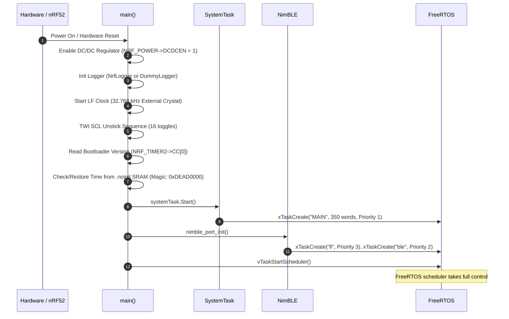
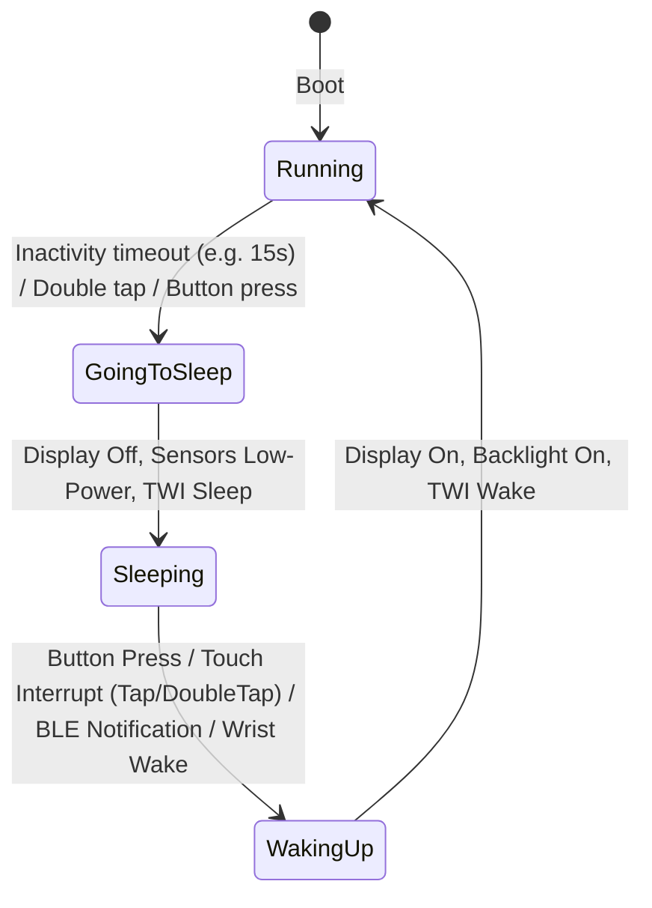

# WristOS Firmware — System Architecture Specification

## 1. Executive Summary
**WristOS** is a custom smartwatch operating system built upon the rock-solid foundation of the open-source **InfiniTime** firmware for the **PINE64 PineTime (Sealed Edition)**.

The architecture is specifically structured for real-time responsiveness, battery efficiency, and rock-solid reliability on an ultra-constrained ARM Cortex-M4F microcontroller.

---

## 2. Firmware Entry Point & Initialization Sequence
The core entry point is located in `firmware/src/main.cpp:317` (`int main()`):



### Detailed Initialization Steps:
1. **DC/DC Internal Regulator**: Switched on to cut current draw by ~30% compared to LDO mode.
2. **Low-Frequency Clock (LFCLK)**: Initialized with external 32.768 kHz crystal oscillator (`nrfx_clock_lfclk_start()`).
3. **I2C/TWI Bus Recovery**: P0.07 (SCL) is pulsed 16 times as output before TWIM initialization to ensure no slave device (CST816S, BMA421, HRS3300) holds SDA low after a reset.
4. **Bootloader Version Handshake**: The MCUBoot bootloader places its version into the hardware timer register `NRF_TIMER2->CC[0]`.
5. **NoInit SRAM Retention**: System date/time is saved across warm resets in uninitialized SRAM (`.noinit` section) validated by the magic word `0xDEAD0000`.
6. **FreeRTOS Scheduler Launch**: `vTaskStartScheduler()` begins execution of all RTOS tasks.

---

## 3. FreeRTOS Task Architecture

InfiniTime uses a preemptive FreeRTOS kernel with a dedicated task hierarchy:

| Task Name | Source File | Stack Size (Words / Bytes) | Priority | Purpose |
| :--- | :--- | :--- | :--- | :--- |
| **`MAIN`** | `src/systemtask/SystemTask.cpp` | 350 words (1,400 B) | 1 (Normal) | Central state machine, power management, button & touch debouncing, watchdog refresh. |
| **`displayapp`** | `src/displayapp/DisplayApp.cpp` | 800 words (3,200 B) | 0 (Low) | LVGL UI execution, display SPI rendering, screen transitions. |
| **`Heartrate`** | `src/heartratetask/HeartRateTask.cpp` | 500 words (2,000 B) | 1 (Normal) | PPG sampling at 25 Hz from HRS3300, digital filtering, BPM calculations. |
| **`ll`** | NimBLE port (`nimble_port_freertos.c`) | ~328 words (1,312 B) | High | NimBLE Link Layer real-time radio scheduling. |
| **`ble`** | NimBLE port (`nimble_port_freertos.c`) | ~728 words (2,912 B) | Above Normal | NimBLE Host GAP/GATT protocol execution. |
| **`LOGGER`** | `src/logging/NrfLogger.cpp` | 200 words (800 B) | 0 (Low) | RTT / UART asynchronous log drain (Debug builds only). |

---

## 4. System State Machine & Power Management

The `SystemTask` manages device power modes:



- **Running Mode**: LCD backlight powered (1.5 mA - 10 mA depending on brightness level), full sensor polling, display refreshed at up to 20-30 FPS on interaction.
- **Sleeping Mode**: ST7789 display put to sleep (`DISPOFF`, `SLPIN`), LCD backlight disabled, CST816S touch controller set to low-power wake-on-touch, BMA421 accelerometer in low-power gesture mode, HRS3300 powered off if not actively measuring, nRF52 enters System ON sleep mode (`__WFE()`). Sleep current is ~25-40 µA.
- **WakeLocks**: Tasks acquire wake locks (`wakeLocksHeld`) to prevent sleep during critical operations (e.g. BLE file transfers, active sports tracking, timer countdowns).

---

## 5. LVGL UI Subsystem

- **LVGL Version**: Custom lightweight build of LVGL v7.x.
- **Frame Buffer Model**: Single 240×240 pixel canvas with line buffers (typically 20 lines) pushed via SPI using DMA.
- **Screen Architecture**: All views inherit from `Pinetime::Applications::Screens::Screen`.
  - Virtual lifecycle methods: `OnTouchEvent()`, `OnButtonPushed()`, `Refresh()`.
  - Automatic teardown: Destructors delete LVGL objects cleanly, avoiding heap fragmentation.
- **Navigation Model**:
  - `DisplayApp` maintains an internal navigation stack (`StaticStack<Apps, 8> returnAppStack`).
  - Swipes trigger directional push/pop transitions (`Up`, `Down`, `Left`, `Right`, `LeftAnim`, `RightAnim`).

---

## 6. Controllers Architecture (Dependency Injection)

Rather than global singletons, InfiniTime uses a unified `AppControllers` struct passed down into applications:

```cpp
struct AppControllers {
  Controllers::Battery& batteryController;
  Controllers::Ble& bleController;
  Controllers::DateTime& dateTimeController;
  // ... Motion, HeartRate, NotificationManager, Motor, Timer, FS, etc.
};
```

This clean architecture allows:
1. Complete mocking and isolation for unit testing.
2. Full portability to the **InfiniSim** native simulator on macOS/Linux.
3. Explicit control over hardware access.
